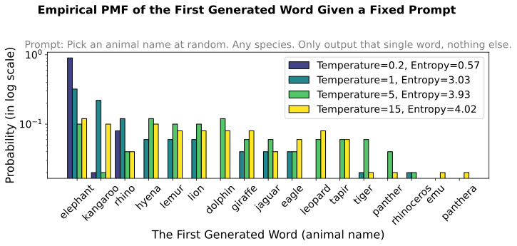
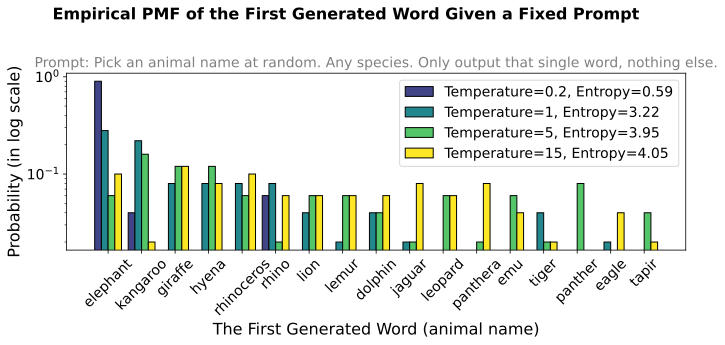

# How does temperature sampling influences token output generation?

To answer this question, we study how temperature affects the **probability mass function (PMF)** of the *first word* produced by a quantized large language model (LLM) in response to a fixed prompt.

The first generated word can be treated as a **discrete random variable**, from model’s vocabulary (tokens) to the space of words. This vocabulary is determined by the tokenizer used during training.

Since the true PMF of the first word is unknown, we estimate it empirically using "independent" samples of model responses.

## Random experiment
Fix a text *prompt* and pick a temperature in $[0,\infty).$ 

1. Generate 50 text responses over independent chats. Follow the link [/experiments/exp_0/outputs/](/experiments/exp_0/outputs/) to see folder with responses.
2. Sample each text response at the first word. We obtain a random sample drawn from the first word's distribution.

3. Estimate the PMF by constructing a bar plot of counts vs unique word categories in the sample.

## Results:

We ran the above experiment with the following prompt. 

```Python
prompt = "Pick an animal name at random. Any species. Only output that single word, nothing else."
```
The figures below show the obtained emperical PMFs up to a normalizing constant. This includes six different configurations given by changes in the *quantized LLM models* and their *temperature* parameter during generation.  

**Meta-Llama-3.1-8B-Instruct**
<div style="text-align: center">
 
</div>

<figcaption> Empirical PMF of the first generated word at different temperatures. </figcaption> 

**Mistral-7B-Instruct-v0.3**
<div style="text-align: center">
 
</div>
Empirical PMF of the first generated word at different temperatures. 

## Conclusion:

We can observe for both models that temperature shapes the probability mass of the first word, being at the zero temperature, a deterministic outcome, all mass is concentrarted at a single word, as we increase temperature from 1 to 15, we probabily mass skews and flattens tending to unfirrom at infinite temperature. In other words at low temperatures the models are more conservative while at higher temperatures they become more creative!
